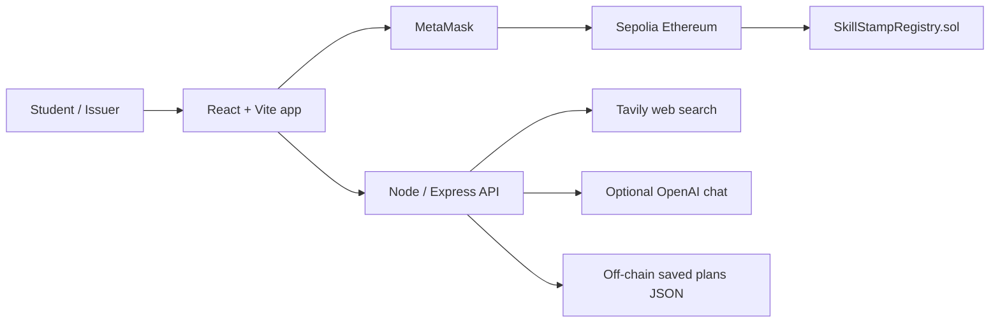

# SkillStamp 2.0 implementation and verification status

This report describes the source bundle, not a claim that the application is deployed or production-audited.

## Implemented in this bundle

- React/Vite/TypeScript application with passport, issuer, verification, leaderboard, skills, settings, opportunities, and learning-assistant routes.
- Solidity `SkillStampRegistry` contract, Hardhat configuration, Sepolia deployment script, ethers.js reads/writes, MetaMask wallet handling, and contract tests.
- Opportunity discovery endpoint using server-side Tavily credentials, normalized source URLs, deduplication, filters, and a clearly labeled evergreen fallback when live search is not configured.
- Optional server-side OpenAI chat endpoint and deterministic roadmap generation when the AI key is absent.
- Floating Opportunity Compass assistant available throughout the app; it handles loading/errors and links to source-backed opportunity discovery.
- Wallet-signature challenge for saved-plan API access, off-chain saved opportunity statuses, optional consent-based geolocation, manual city selection, and environment-variable examples.
- Basic in-process API rate limiting, configurable CORS origins, JSON request size limit, and upstream request timeouts.

## Not verified / blocked

- **Sepolia deployment: BLOCKED** until a real RPC URL, funded disposable test wallet, and deployment transaction are provided by the operator. `src/config/deployment.json` intentionally has an empty contract address; no address or transaction hash is fabricated.
- **Live opportunity search: BLOCKED** without `TAVILY_API_KEY`. Without it, the endpoint returns labeled evergreen learning resources, not current event listings.
- **AI chat: BLOCKED** without server-side `OPENAI_API_KEY`.
- **Production persistence: PARTIAL**; saved data is stored in a local JSON file. Use a database and shared rate limiter for a deployed multi-instance server.
- **Security audit: NOT PERFORMED**. The in-process rate limiter is a demo safeguard, not production-grade abuse protection.
- **Build and automated tests: BLOCKED in this environment** because dependency installation did not finish and `node_modules` is absent. `node --check server/index.mjs` passed; `npm run test:opportunities` could not execute because package `ethers` was not installed. Do not treat that as a test pass.

## Required verification commands

```bash
npm install
npm run compile
npm test
npm run test:opportunities
npm run typecheck
npm run build
```

Then configure `.env`, fund a test wallet, and run:

```bash
npm run deploy:sepolia
npm run server
npm run dev
```

Use MetaMask on Sepolia and demonstrate a real credential issuance, public verification, unauthorized operation rejection, revocation, and updated active points. Record the real transaction hashes and Sepolia explorer URLs only after confirmation.

## Architecture



## Evaluation evidence checklist

- [ ] Functionality: connect MetaMask; issue, verify, revoke; test points; search and save opportunities; use roadmap/chat; inspect failure states.
- [ ] Innovation: show proof-of-participation passport and how verified achievements can inform next-step guidance without AI issuing credentials.
- [ ] Presentation: explain architecture, privacy boundary, official source links, and limitations.
- [ ] Contract execution: compile/test, deploy to Sepolia, and show confirmed real transactions and explorer links.
- [ ] UI/UX: check mobile and desktop navigation, accessible labels, loading/error/empty states, and the floating Compass assistant.

Items remain unchecked until demonstrated with execution evidence.
